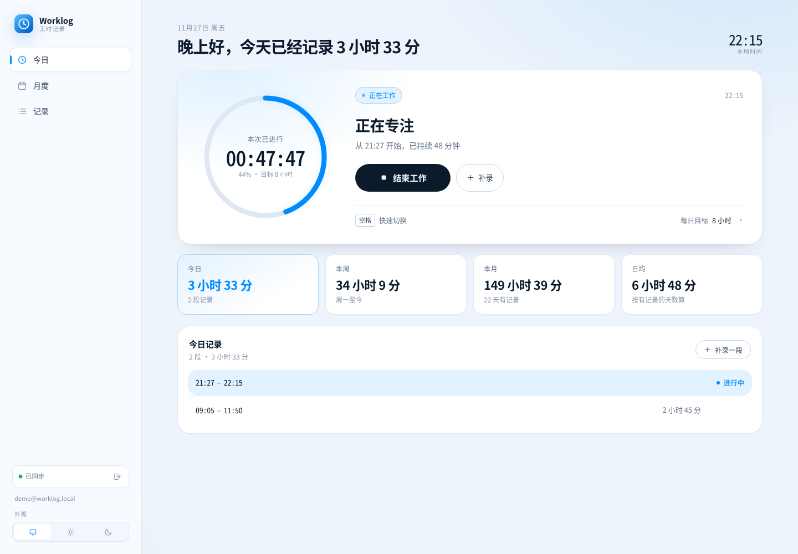
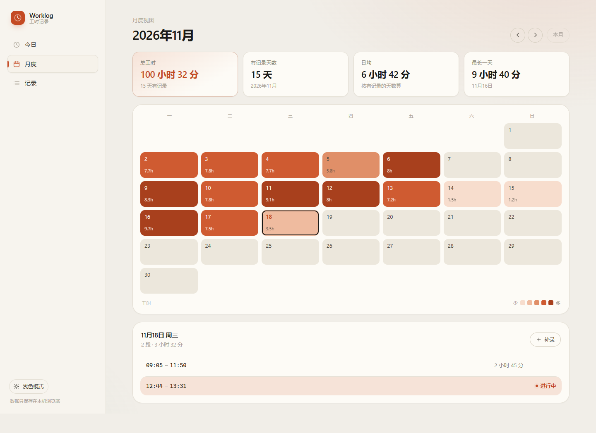

<div align="center">

# Worklog · 工时记录

**一个只存在你浏览器里的工时记录小工具。**

按下开始，按下结束，然后在月历里看这个月每天工作了多久。

<sub>Local-first work time tracker — punch in, punch out, see your month as a heatmap.</sub>

[](https://react.dev)
[](https://www.typescriptlang.org)
[](https://vite.dev)
[](https://zustand.docs.pmnd.rs)
[](https://sass-lang.com)
[](#数据与隐私)

<sub><a href="#功能">功能</a> · <a href="#快速开始">快速开始</a> · <a href="#数据与隐私">数据说明</a> · <a href="#技术栈">技术栈</a></sub>

</div>

<p align="center">
  
  
</p>

## 为什么做这个

市面上大多数时间追踪工具，要么要注册账号、把数据传到云端，要么为了记一笔工时塞进一整套项目管理功能。

Worklog 只做一件事：**记录你什么时候在工作**。

- 没有账号，没有后端，数据不离开浏览器
- 打卡只需要一次点击，或者按一下空格
- 月历热力图，一眼看出这个月哪几天在认真工作
- 随时导出 JSON / CSV，数据永远是你的

> 不计算薪资，也不做项目管理，只回答一个问题：这个月我工作了多久？

## 功能

|                    |                                                                |
| ------------------ | -------------------------------------------------------------- |
| 🕒 **一键打卡**    | 开始 / 结束一段工作，刷新或关闭页面都不会丢失正在进行的计时    |
| 📊 **今日概览**    | 本次计时、今日 / 本周 / 本月 / 日均，配合每日目标进度环        |
| 🗓️ **月度热力图**  | 整月一张图，颜色越深工时越长；点选某天查看或补录               |
| 🌙 **跨零点处理**  | 22:30–01:10 会自动拆分到两天，日统计不会多算                   |
| ✍️ **手动补录**    | 忘记打卡时补一段；默认落在最近的空闲时段，并校验重叠与未来时间 |
| 🔔 **忘关提醒**    | 一段计时超过 16 小时会提醒，可结束或作废                       |
| 💾 **导入导出**    | JSON（含设置）与 CSV；导入按 id 去重合并                       |
| 🎨 **深色 / 浅色** | 跟随系统，也可手动切换；桌面与手机都有对应布局                 |

## 快速开始

需要 Node.js ≥ 22 与 pnpm。

```bash
git clone https://github.com/Talyra42/worklog.git
# 或者用 SSH：git clone git@github.com:Talyra42/worklog.git
cd worklog
pnpm install
pnpm dev        # http://localhost:5173
```

生产构建与预览：

```bash
pnpm build
pnpm preview
```

## 使用

- 点「开始工作」开始计时，再点「结束工作」完成一段记录。
- 在「今日」页按 `空格` 可以快速开始 / 结束；输入框和弹窗内不会触发。
- 忘记打卡时用「补录」，或者在「月度」页点选某一天补录。
- 「每日目标」默认 8 小时，可在计时卡片右下角调整，进度环会跟着变化。
- 所有记录都可以在「记录」页编辑、删除、导出。

## 数据与隐私

- 数据保存在浏览器 `localStorage`，key 为 `worklog.store.v1`。
- 没有账号体系，也没有任何业务网络请求（除了加载页面本身）。
- 清理浏览器数据、换浏览器或换设备前，请在「记录」页导出 JSON。
- 导入时按 `id` 去重，重复记录会自动跳过。

数据结构只保留原始区间：

```ts
type Session = {
  id: string
  start: number // epoch ms
  end: number // epoch ms
}
```

日统计、月统计、热力图等级全部由区间实时推导，不存累计值——所以补录、改时间、跨零点都不会让历史汇总失真。

## 技术栈

| 层   | 选择                                             |
| ---- | ------------------------------------------------ |
| 框架 | React 19 + TypeScript                            |
| 构建 | Vite 8                                           |
| 状态 | Zustand 5（`persist` 中间件持久化）              |
| 样式 | SCSS Modules + CSS 变量主题                      |
| 日期 | dayjs                                            |
| 质量 | oxlint、Prettier、husky、lint-staged、commitlint |

## 目录结构

```
src/
├── components/   计时环、月历、记录行、弹窗、Toast…
├── views/        今日 / 月度 / 记录
├── store/        Zustand：工时数据、弹窗、Toast
├── lib/          时间工具、跨天拆分与月统计、备份
├── styles/       主题变量与全局样式
└── hooks/        useNow 等
```

## 可用脚本

| 命令                | 说明                      |
| ------------------- | ------------------------- |
| `pnpm dev`          | 本地开发                  |
| `pnpm build`        | 类型检查 + 生产构建       |
| `pnpm preview`      | 预览构建产物              |
| `pnpm lint`         | oxlint                    |
| `pnpm lint:fix`     | oxlint 自动修复           |
| `pnpm format`       | Prettier 格式化           |
| `pnpm format:check` | 检查格式是否符合 Prettier |

## 开发约定

- 提交信息遵循 Conventional Commits（`feat:`、`fix:`、`docs:`…），由 commitlint 校验。
- 提交前 husky 会运行 lint-staged，对暂存文件执行 oxlint 与 Prettier。
- 数据层与 UI 解耦：统计逻辑在 `src/lib/stats.ts`，可以单独测试或替换存储实现。

## Roadmap

- [ ] 多设备同步（需要后端或端到端加密方案）
- [ ] 项目 / 标签维度
- [ ] PWA 安装与离线缓存
- [ ] 更细的统计（按周、按项目、按标签）

---

<p align="center"><sub>用一个「不打扰」的工具，记录你真正投入的时间。</sub></p>
